# Coy — Discover

A mobile-first React app with an Express API and SQLite persistence, built for the Coy SDE Intern Assignment. Discover shows one profile at a time; likes stay private until they are mutual. Home contains an optional suggestions note requested during development; dismissing it leaves the placeholder blank.

## Run locally

Requires **Node.js 22.13+** (built-in SQLite).

```sh
npm ci
npm run dev
```

Open **http://localhost:3000**. For a production build:

```sh
npm run build
npm start
```

Optional environment variables must be exported before starting; `.env` is not loaded automatically:

| Variable | Default | Purpose |
| --- | --- | --- |
| `PORT` | `3000` | HTTP port |
| `DATA_FILE` | `data/coy.sqlite` | Persistent SQLite file |
| `COOKIE_SECURE` | `false` | Set to `true` behind HTTPS |
| `CHROME_PATH` | `/usr/bin/google-chrome` | Chrome executable for browser tests |

Use a persistent disk for SQLite. The app is intended for a single Node server, not ephemeral serverless storage. HTTPS is required for camera/geolocation on shared deployments; localhost is allowed for local testing.

## Assignment checklist

| Requirement | Implementation / status |
| --- | --- |
| React frontend, Node backend, persistent data | React + Vite, Express, SQLite |
| Mobile-first; Home placeholder | Narrow responsive layout; optional dismissible suggestions note |
| At least 30 profiles | 32 adult mock profiles with name, age, image, bio, city/college and interests |
| Seeded incoming likes | Some mock profiles privately like each new demo user |
| One profile at a time | Drag right to like, left to pass; desktop buttons |
| Animations and feedback | Card dismissal, drag stamps, loading/error states |
| No repeated swiped profiles | Server excludes all recorded likes and passes |
| Empty state | Explicit exhausted-feed screen |
| Mutual match only | Reverse like checked server-side; unique pair stored atomically |
| Match celebration | “It’s a match!” dialog on creation |
| Matches list | Mutual matches only |
| Incoming-like privacy | Explicit public field allowlist; no incoming-like payloads |
| `GET /feed`, `POST /swipe`, `GET /matches` | Implemented and tested |
| Reload/restart persistence | SQLite stores profiles, sessions, decisions and matches |
| Public GitHub source | This repository |
| Part A: two feature suggestions | [Unsent and Encounter, with rationale](docs/PART_A.md) |
| Part A: authenticated live Coy walkthrough | **Pending** — see research status below |

The app opens without registration or external authentication. To support the requested multi-user extension, each browser gets one assumed logged-in user through an opaque, HttpOnly session cookie. Separate private/browser contexts act as separate users. Sessions last 30 days; clearing cookies starts a new identity. This is not verified account authentication or cross-device login.

## Screenshots and features

Screenshots below are captured from the running production build with isolated, fictional sample data. To reproduce them: `npm run build && node scripts/screenshots.mjs`.

### Discover

One card at a time, a short introduction, interests, mobile drag gestures, desktop buttons and an optional location permission prompt. Swipes are unlimited. Likes are not revealed before mutuality.

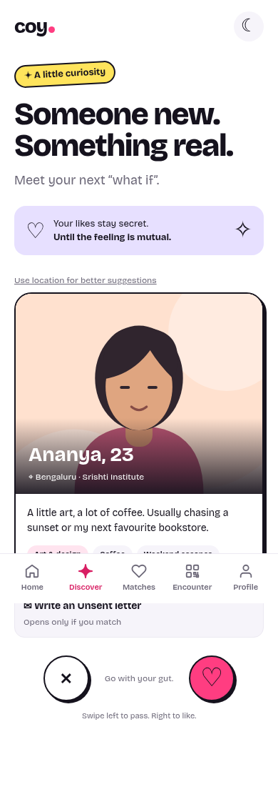

### Unsent

Write a private letter without sending a like. Only the author can access it before a mutual match. Recipients open it through **Open Unsent letter** in Matches. Clearing and saving removes it; removal cannot undo prior reading or copying.

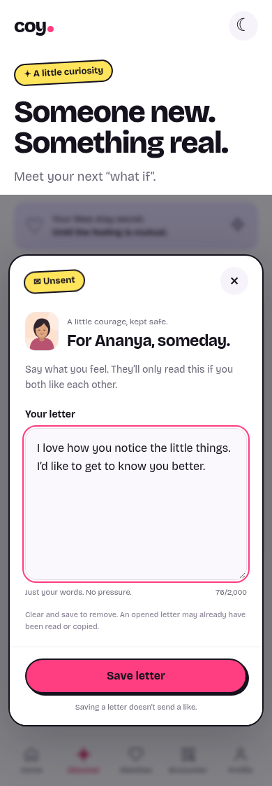

### Mutual match and Matches

A match celebration appears only when a new reciprocal like creates a match. Matches lists only mutual connections. The green WhatsApp icon and **Say hi** button is intentionally inactive: it does not navigate, share contacts or send messages.

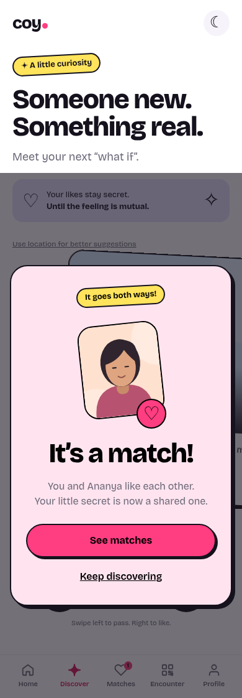 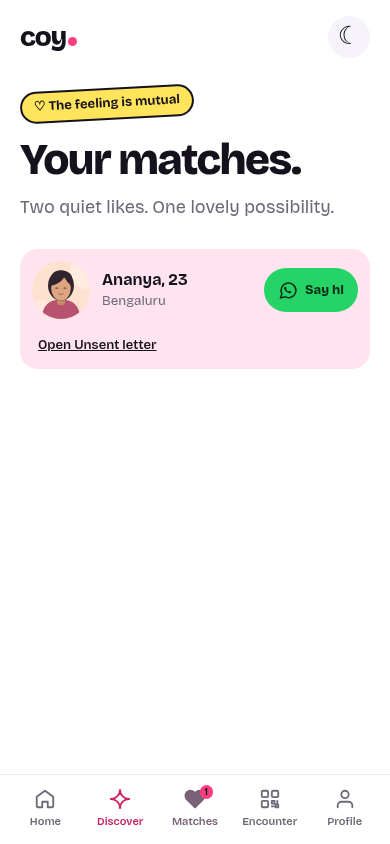

### Editable profile and personal QR

Edit name, adult age, city, college, interests and a short bio. Upload a JPEG/PNG/WebP photo or select an avatar. Profiles start private; publishing is opt-in. Unpublishing hides the profile from other users.

The compact **My QR** control sits beside the photo. Its QR contains only `{name, id}`; the ID is the stable random profile UUID, not a session secret. The server resolves the ID to the current published profile and never trusts the scanned name. It contains no phone number. This is a persistent profile QR, not an expiring invitation.

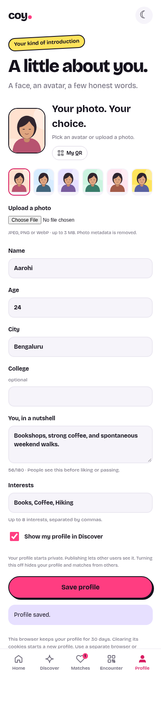 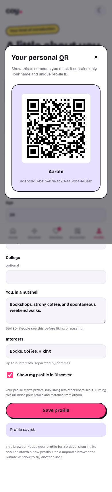

### Encounter and camera scanner

Generate your QR in Profile and scan someone else's QR in Encounter. Scanning saves that person to your own **Your encounters** list without sending a like. Saved encounters survive reloads. Later, **Add as a crush** records a like using the same mutual-match rules. An earlier pass cannot be changed.

The camera asks permission and decodes frames locally. Tracks stop after success, closing, hiding the page or leaving the section. There are no link inputs or QR-image upload controls. The scanner screenshot shows its camera-permission fallback; physical phone camera hardware has not been verified in this environment. Browser tests feed actual QR pixels through a simulated camera MediaStream.

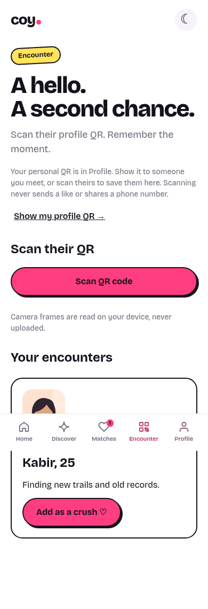 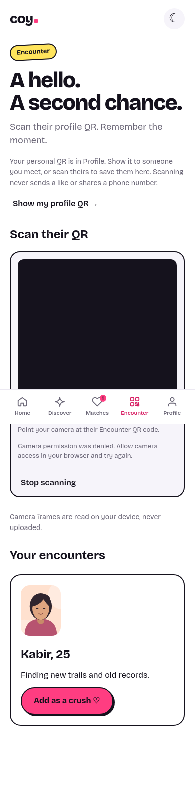

### Dark mode, empty state and blank Home

Dark mode is saved locally. Exhausting the feed shows a clear empty state. Home shows a small dismissible note about Unsent and Encounter. Dismissal is saved locally and leaves Home blank. The full proposals are in Part A documentation.

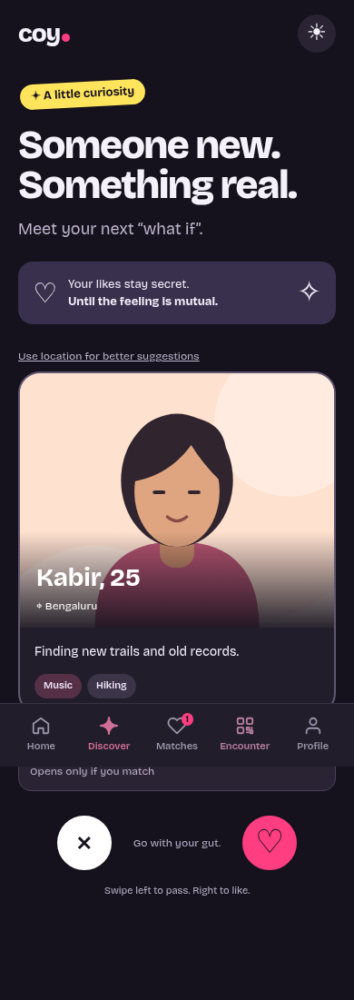 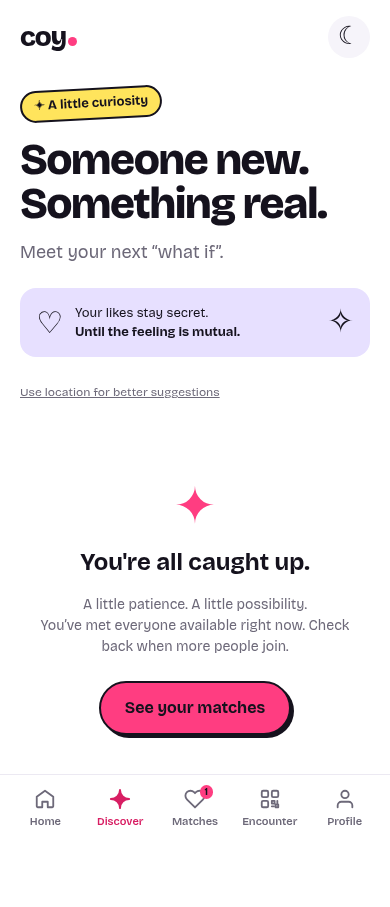 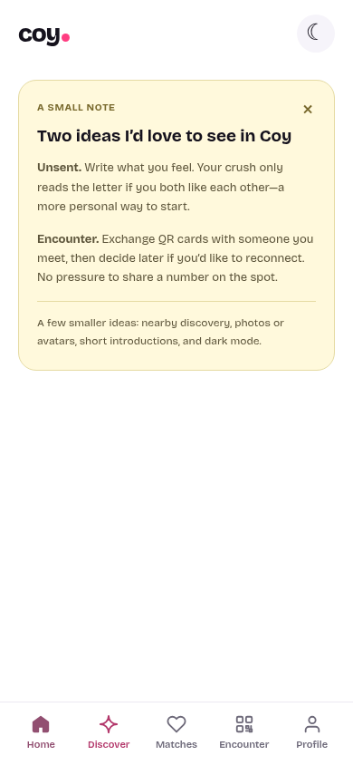

### Optional location

Discover asks for consent. **Allow location** triggers browser geolocation; **Not now** keeps the feed unrestricted. Coordinates are rounded to 0.01 degrees before storage. The server applies a Haversine radius filter (50 km by default); only approximate distance rounded up to 5 km is returned. Unknown locations are excluded while filtering. **Clear location** deletes stored coordinates. Location inference is still possible from coarse proximity; this is not an anonymity guarantee.

## Backend design

- Parameterized SQLite statements, foreign keys, WAL and a busy timeout.
- Decisions and mutual matches commit in one `BEGIN IMMEDIATE` transaction. Composite keys prevent duplicate decisions and pairs.
- Repeating an identical swipe is idempotent and does not replay a new-match celebration. Attempting to change a recorded action returns 409.
- Client identity comes from a random cookie secret; only its hash is stored server-side. Clients cannot choose another user's identity.
- State-changing APIs require `X-Coy-Request: 1`, reject cross-site fetches/foreign Origins, and do not allow CORS. Helmet sets security headers.
- Profiles use an explicit public field allowlist. Received letters require server-side mutuality checks; feed/match-list payloads never include letters or private contact details.
- Uploads are limited to 3 MB and 20 million pixels, decoded with Sharp, re-encoded to WebP and stripped of metadata including EXIF GPS. Original filenames are not used as paths. Image access respects profile visibility.
- Errors return controlled messages. Network failures clear stale feed cards and provide a retry action.

### API contracts

Begin with `POST /session` to obtain/reuse a browser user. All mutation requests require the custom header above; JSON requests use `Content-Type: application/json`.

| Endpoint | Request / response |
| --- | --- |
| `GET /feed` | `{ profiles: [...] }` — visible unswiped public profiles |
| `POST /swipe` | `{ profileId, action: "like" or "pass" }` → `{ matched, match? }` |
| `GET /matches` | `{ matches: [...] }` — only mutual visible matches |
| `GET /me` | Own editable profile and settings |
| `POST /profile` | Validated editable fields; only own profile |
| `POST /location` | `{ enabled, latitude?, longitude?, radius? }` |
| `POST /photo` | Raw JPEG/PNG/WebP bytes |
| `GET /media/:owner` | Authorized normalized image |
| `GET/POST /letters/:target` | Own letter only; write `{ body }` |
| `GET /connections/:target` | Mutual-only received letter and legacy conversation data |
| `POST /encounters/profile` | `{ profileId }` from QR; save encounter without liking |
| `GET /encounters/saved` | Own saved visible encounters |
| `POST /encounters/saved/:target/like` | Add saved encounter as a crush |

Invalid input returns 400, unavailable resources 404, incompatible previous decisions 409, oversized uploads 413, and API rate limits 429. Legacy temporary-card/chat/contact endpoints remain for existing prototype data; the active UI uses profile QR scanning and the inactive WhatsApp placeholder. They are still session-scoped and privacy-checked.

## Testing

```sh
npm test
npm run build
npm run test:ui
npm run format:check
npm audit --omit=dev
```

Backend tests cover user isolation, mutuality, private payloads, idempotency, SQLite reopening, feed exhaustion, geographic filtering, session/CSRF checks, malformed input, uploads, private letters and Encounter ownership. Browser tests run an isolated production server/database and cover touch swiping, desktop buttons, reload persistence, blank Home, match creation, profiles, avatars/uploads, location consent, dark mode, camera QR exchange, saved encounters and the inert WhatsApp button.

Tests do not modify your working demo database. `CHROME_PATH` can override the browser executable. These checks establish the tested behavior; they are not a guarantee that every device or deployment is bug-free.

## Demo in two minutes

1. Open Discover. On a fresh session, like Ananya to create a seeded mutual match.
2. Open Matches; inspect the inactive Say hi button and letter control.
3. Return to Discover, pass a profile, reload and confirm it does not reappear.
4. Edit and publish Profile; choose an avatar and open My QR.
5. Use a separate browser context for another user. Publish its profile and scan the first user's QR to save an Encounter. Like each other to demonstrate real mutuality.
6. Try dark mode and location permission. Complete the feed to see the empty state.

## Part A research and remaining limitations

[Part A](docs/PART_A.md) proposes **Unsent** and **Encounter** and explains why each would help. The live Coy public login was inspected. Actual phone OTP completion, adding a crush, email verification, invite destination and extra-slot screen remain **unverified** because no authenticated live session was available. Complete that firsthand walkthrough before submitting; do not claim the local prototype completes those research steps. Do not purchase extra slots.

The original brief assumes one user. Browser-isolated users and the Profile/Encounter tabs are optional extensions requested during development. The optional Home note extends the original blank-Home requirement and can be dismissed. No external auth or payment integration is included.

Before public production use, add verified account login/recovery/deletion, moderation/blocking, abuse controls for new identities and deployment-specific infrastructure. SQLite images and anonymous identities are suitable for this assignment prototype, not a complete consumer service. The interface follows Coy's public visual language and uses its publicly served font as reference; this is an unofficial project.

The full dependency audit currently reports an unpatched development-only `picomatch` advisory through Vite ([GHSA-fc5q-39xc-vjpf](https://github.com/advisories/GHSA-fc5q-39xc-vjpf)); production dependencies are checked separately. Avoid untrusted glob inputs and recheck for a patched release. No forced major-version downgrade was applied.
